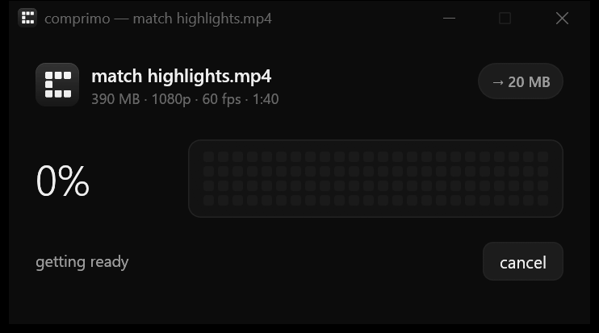
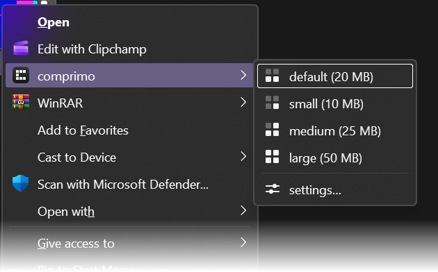
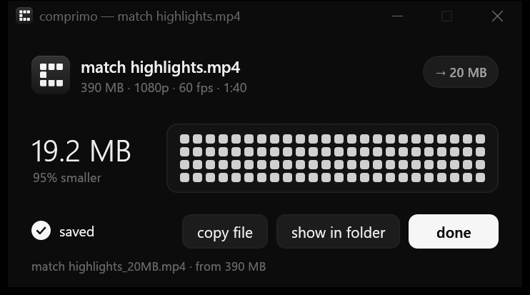
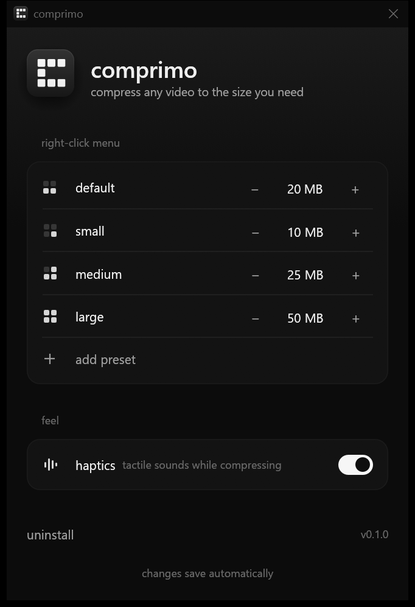

  

<h1 align="center">comprimo</h1>

  <b>Right-click any video. Get a copy that fits.</b> 
  Shrink videos to a size limit in seconds, with the best quality that fits.

  

  
  
  

  

Too big to send? *comprimo* (Latin for "I squeeze") turns any video into a copy that fits under the
size you need, like 10 MB for a chat app or 25 MB for an email, without you having to know anything
about video settings. Install it once and forget about it: it lives in your right-click menu and
nowhere else.

## Install

1. **[Download comprimo.exe](https://github.com/brnbtt/comprimo/releases/latest/download/comprimo.exe)**
   (about 6 MB).
2. Open it and press **install**. No admin rights needed, and it takes a couple of seconds.
3. That's it. You can delete the file you downloaded.

> [!NOTE]
> comprimo isn't code-signed yet, so Windows may show **"Windows protected your PC"** the first
> time. Click **More info → Run anyway**. The app is open source, and you can read every line of it here.

## How to use it

### 1. Right-click a video

Choose **comprimo** and pick a size. The little blocks next to each size show how big it is
compared to the others.

  

> [!TIP]
> On **Windows 11**, comprimo is under **Show more options**. You can also hold **Shift** while you
> right-click to go straight to it.

### 2. Watch it build

A small window shows your new file being built, block by block. It usually takes a few seconds.
You can keep working, or select several videos at once and they'll be done one after another.

### 3. Share it

The new file is saved next to the original as `name_20MB.mp4`, and your original is never touched.
**copy file** puts it on your clipboard so you can paste it straight into a chat, an email or a
folder.

  

## Make it yours

Open **settings…** from the right-click menu to change the default size and to add, rename, resize
or remove your own sizes (up to 14). Changes save by themselves.

  

## Why comprimo

- **It lands under your limit.** comprimo checks the result and fine-tunes it if it came out too
  big.
- **The best quality that fits.** It picks the resolution and frame rate that look best at that
  size, so a long video doesn't turn into a blurry mess.
- **Fast.** It uses your graphics card when it can (NVIDIA, Intel or AMD), so most videos take
  seconds.
- **Plays everywhere.** The result is a standard MP4 that works on phones, browsers and chat apps.
- **Almost any video in:** MP4, MOV, MKV, AVI, WebM, WMV, FLV, MPG, TS, 3GP and more, including
  portrait phone videos.
- **Nothing running in the background.** No tray icon, no startup app, no account, no ads.
- **Private.** Everything happens on your PC. Your videos are never uploaded anywhere.
- **Feels good.** Subtle, tactile sounds as it works (you can turn them off).

## Questions

<b>Where is it in the right-click menu?</b>

 
On Windows 10 it's right there. On Windows 11, click <b>Show more options</b> at the bottom of the
menu, or hold <b>Shift</b> while you right-click.

<b>What if my video can't fit?</b>

 
If a video is far too long for the size (say, a 2-hour movie into 10 MB), comprimo tells you
instead of making something unwatchable. Try a bigger size, or trim the video first. If the video is
already small enough, it just tells you so.

<b>Does it need the internet?</b>

 
Only once, during install, to download its video engine (about 7 MB, from this GitHub project).
After that it works completely offline.

<b>How big is a "MB" here?</b>

 
comprimo counts 1 MB as 1,000,000 bytes, slightly smaller than some apps' definition. That way the
file stays under the limit whichever way a website or app counts.

<b>How do I uninstall it?</b>

 
Go to <b>Settings → Apps → Installed apps → comprimo → Uninstall</b>, or press <b>uninstall</b> in
comprimo's settings. It removes everything, including the right-click entries.

## Under the hood

Curious how it picks quality and speed, or want to build it yourself? See
**[how comprimo works](docs/how-it-works.md)**.

## License

[MIT](LICENSE). comprimo downloads a slim build of [FFmpeg](https://ffmpeg.org), which is licensed
under the GPL (it includes x264); see the `README.txt` and `LICENSE.txt` inside that download.
